# MihonNooir Desktop — preview user guide

> Development preview, not a stable desktop release. The Android v1.0.20 app remains a separate release.

## Choose the package for your computer

| Platform | Architecture | Preview packaging |
|---|---|---|
| Windows | x64 | MSI or portable ZIP |
| Windows | ARM64 | Portable ZIP |
| macOS | Intel / Apple Silicon | Native APP archive; DMG candidate |
| Linux | x64 / ARM64 | Portable tar.gz; DEB/RPM candidates |

All native packages bundle Java 21; no Android emulator or separate Java installation is needed. Automated native builds passed on all six targets at the integrated checkpoint. The [integrated candidate passed all eight automated jobs](https://github.com/toshio2011/mihon-nooir/actions/runs/45572700921), including both Mac GUI and installer payload checks. Physical-machine compatibility, signing/notarization and actual Linux package-manager upgrades remain open. Do not treat development artifacts as an official release.

## First launch and extension setup

For online manga, start or connect to a localhost Suwayomi server. Choose Manage extensions, then Open Suwayomi in browser. Add trusted repositories and install compatible extensions. Return to desktop and reconnect. Offline reading and conversion do not need a server.

The following are actual Windows QA captures of the integrated candidate `7ff39e90bc5f2372ee1ca004e27c24bbb68e2ff7`, with synthetic sample content. Appearance varies by platform.

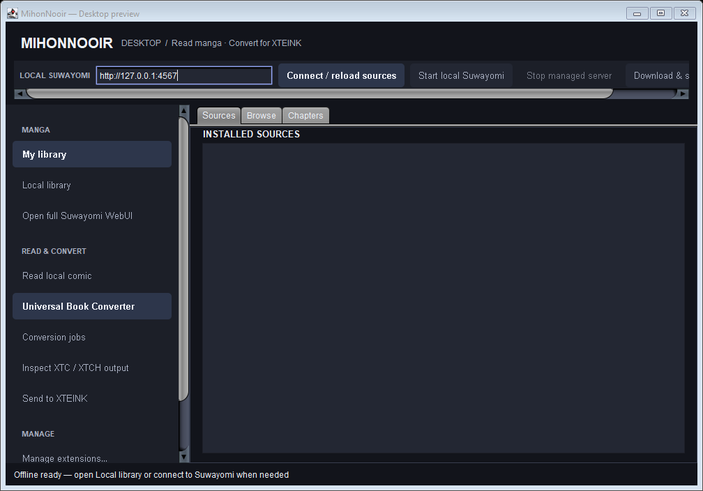

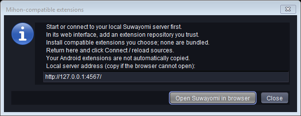

## Read manga

Open the desktop app. Use Local library or the local import workflow for your own books and image folders. For online browsing, explicitly start or connect to a compatible Suwayomi server, configure trusted sources and select a manga and chapter. Use Cover grid or Detailed list. Offline reading and conversion need no running server.

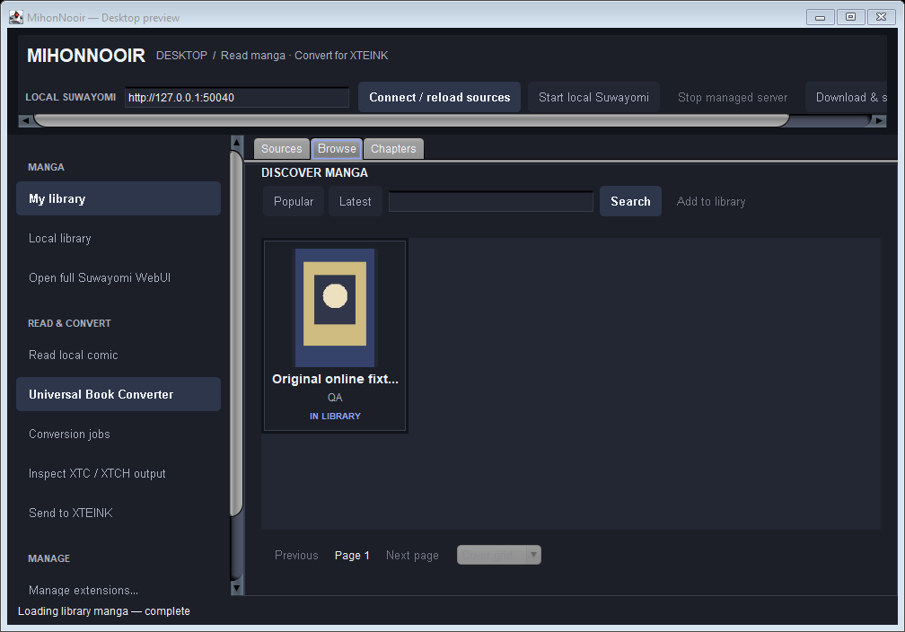

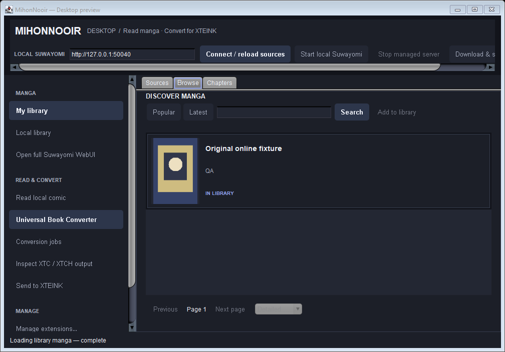

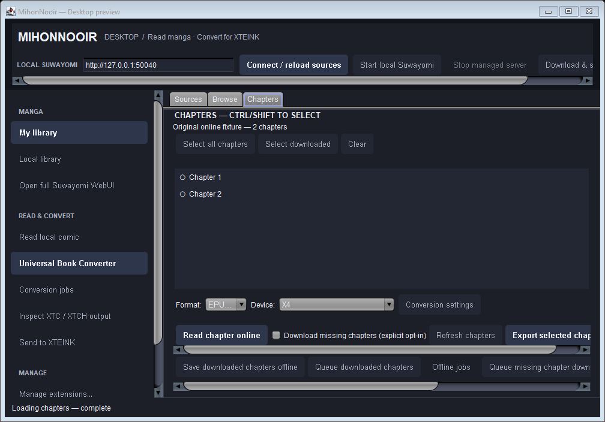

Choose Read chapter online, then navigate pages or chapters. Fit and zoom affect the display. The pictured older candidate saves resume positions locally. In the newer backup integration candidate, use **Save progress to server** after a page is displayed, then create a portable backup. This explicit action does not automatically mark chapters read and will refuse known newer server positions. The screenshots predate this new button.

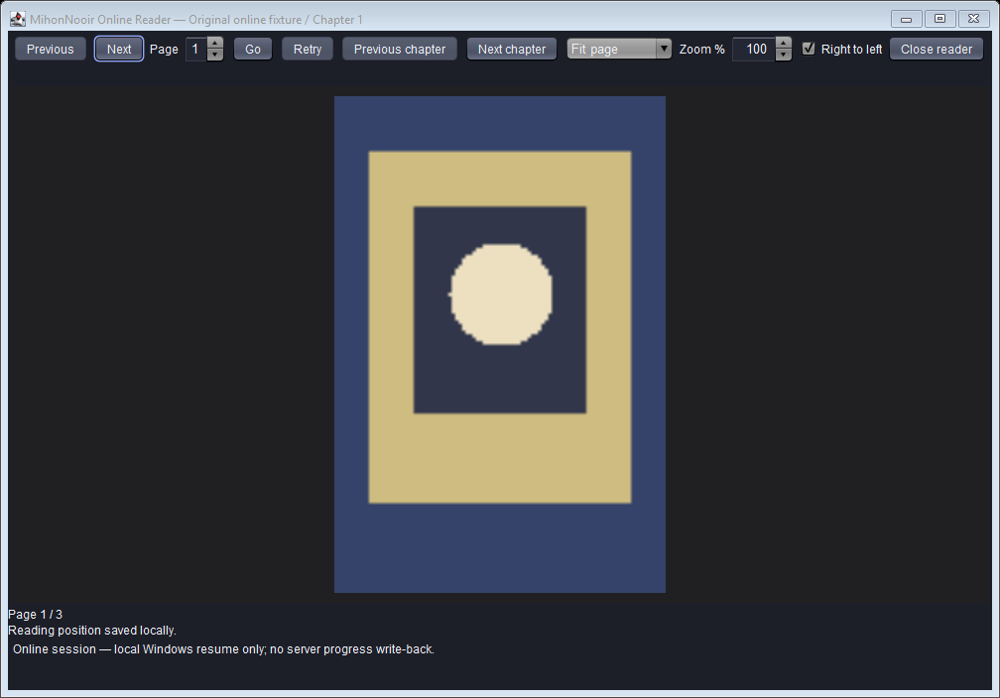

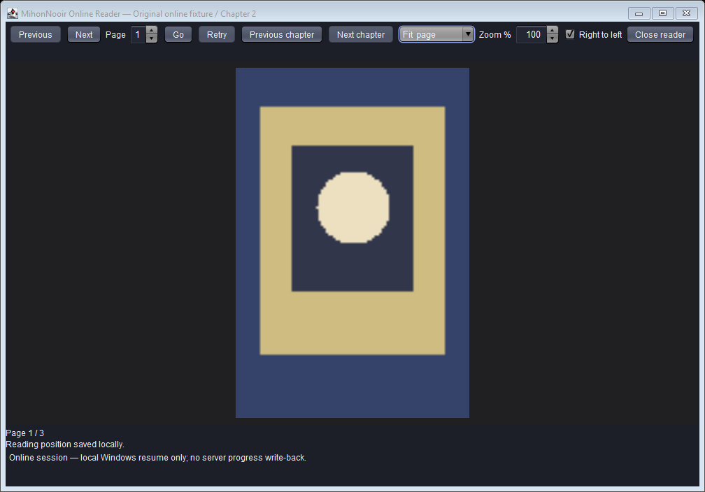

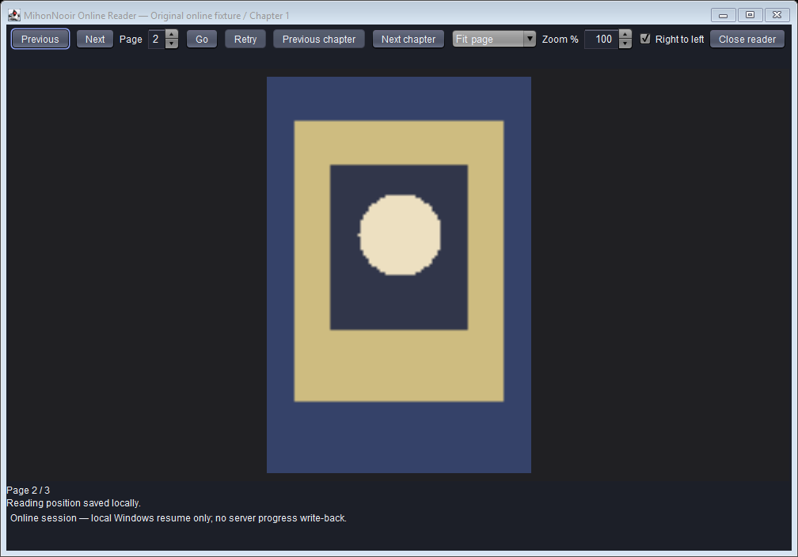

For offline reading, open Local library and choose a local comic or image folder.

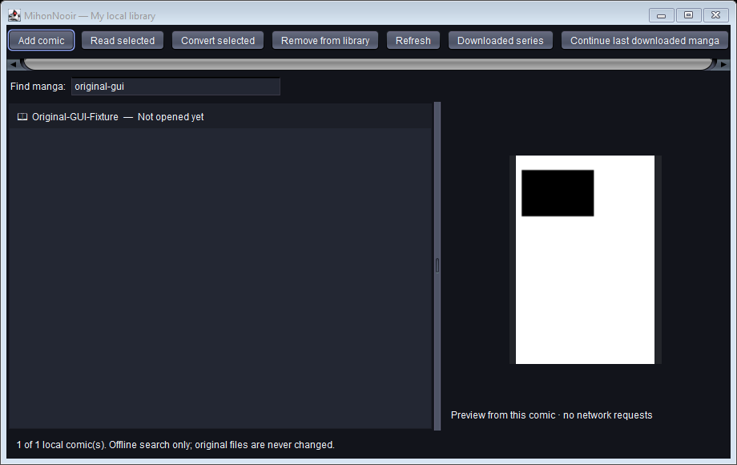

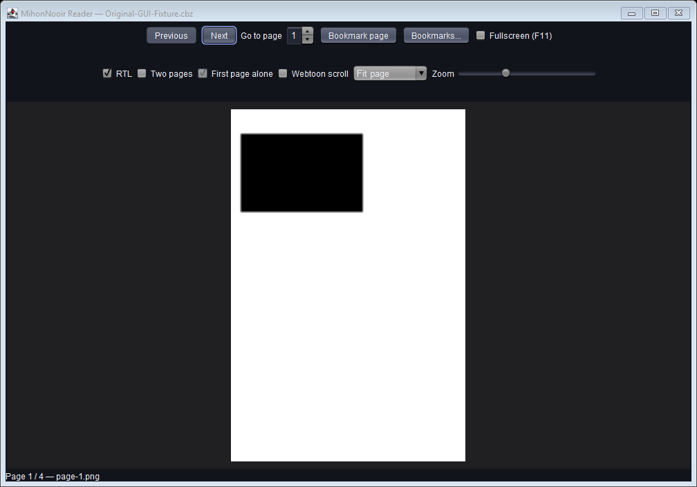

## Universal Book Converter

- Comic / image folder: convert supported manga to EPUB2/3, XTC, XTCH or CBZ with the manga settings.
- PDF / EPUB: choose original PDF pages, hybrid PDF reflow to EPUB, original pages plus selectable text, or EPUB text/image conversion as appropriate.
- Batch conversion jobs: choose the matching input category and output; run explicitly. Pause after the current job, retry failures, or remove finished records.
- Preview finished XTC / XTCH: inspect the actual saved book.
- Web → EPUB: follow the chapter editor workflow below.

For manga, choose the target reader, Apply Manga Settings where available, XTC, Panel by Panel, Auto orientation and Auto Fit. Use a full-page overview or row mode when appropriate. Panel detection is heuristic; check actual output before transferring.

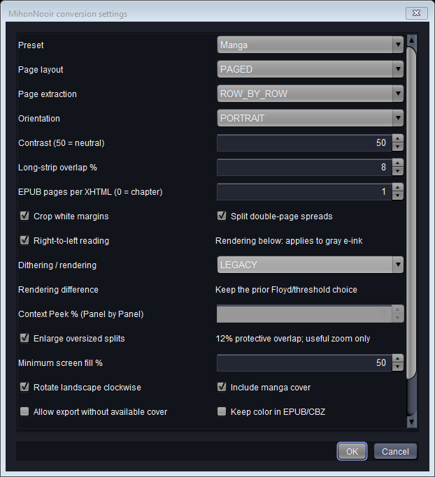

Choose Inspect XTC / XTCH output to decode the actual saved book. The checkerboard is synthetic QA content, not manga. Fit changes the display, not file dimensions.

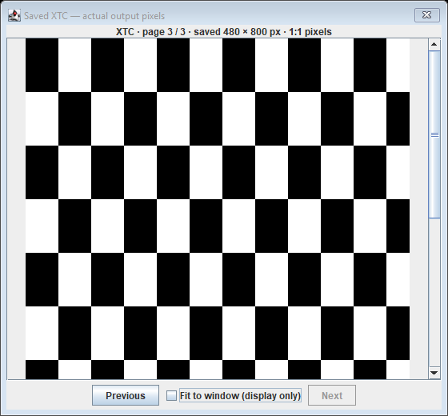

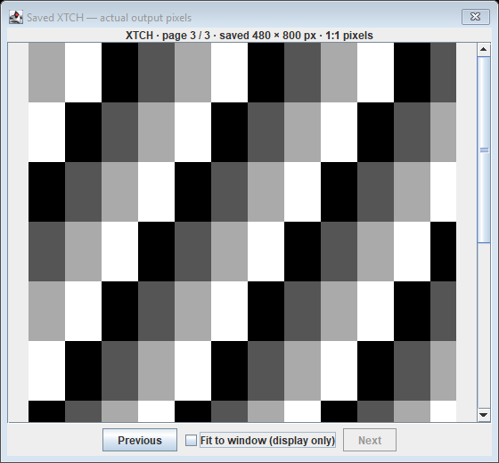

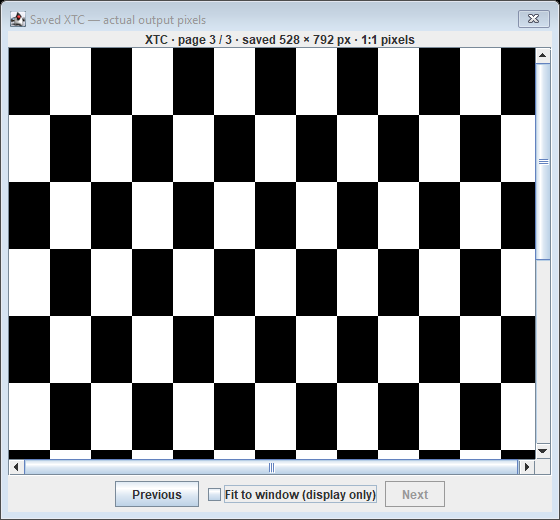

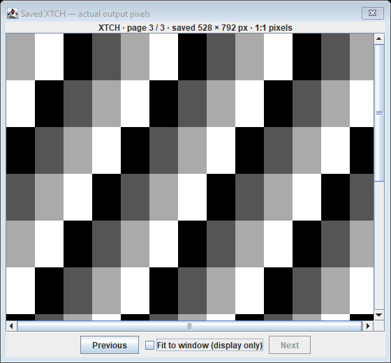

## Public web pages and novels

1. Open Universal Book Converter → Web → EPUB.
2. Paste a public story overview HTTPS link and choose Analyze story chapters, or paste readable chapter URLs one per line and choose Use pasted chapter/page URLs.
3. Check the chapters to include, edit titles, move them up/down or reverse order. Preview a selected chapter.

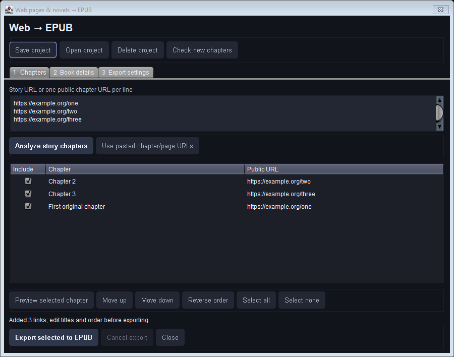

4. Set title, author, synopsis, language, and choose auto cover, public JPEG/PNG URL, local cover, or combined covers.

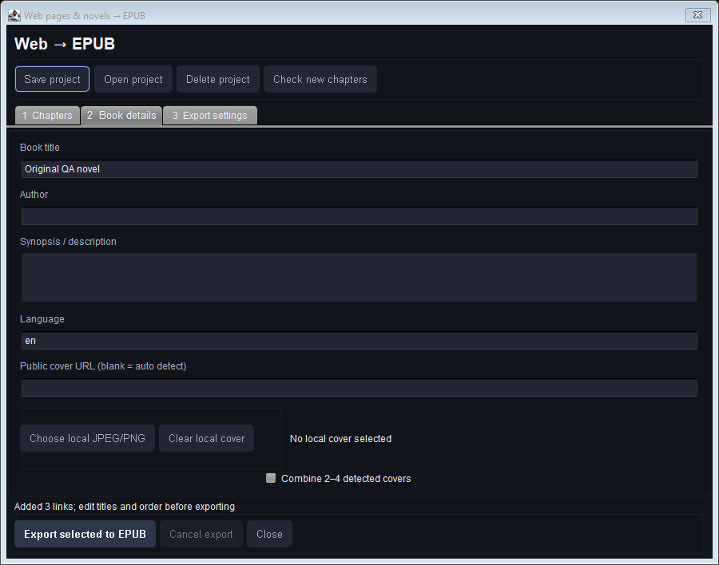

5. Choose EPUB2 or EPUB3, reading style, illustration size and optional extraction selectors/safe EPUB CSS.

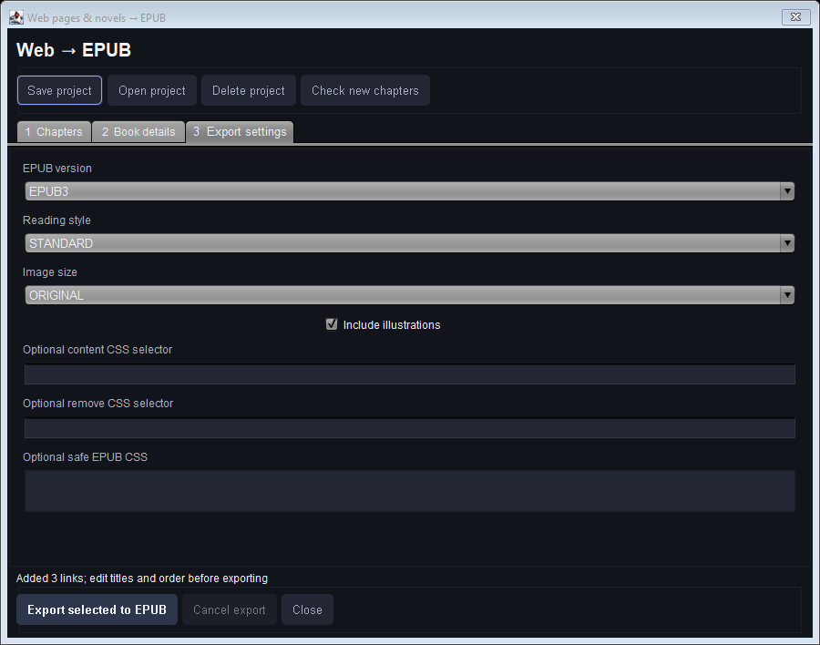

6. Export to a **new** .epub filename. Cancel export requests cooperative cancellation; it may take until the current bounded network operation finishes. Failed/canceled exports do not publish partial books.
7. Save project to retain the chapter list and settings. Open project later and check new chapters; confirm additions, then save again. Existing exported books are not modified.

Wattpad public metadata may supply story-level cover and synopsis. No login session, paywall or restricted chapter access is supported. Site availability varies; the [separate live acceptance test](https://github.com/toshio2011/mihon-nooir/actions/runs/45573117372) passed for one public Wattpad chapter, including cover and synopsis; this does not prove every public novel works. Complex PDF layouts and OCR are not guaranteed; original-page mode remains available.

## Your data and updates

The preview retains data in the existing ~/.mihonnooir folder by default. MIHONNOOIR_DATA_DIR can point to an absolute dedicated folder. Back it up before upgrading or downgrading. Newer conversion queue records may not be readable by old previews. Projects store local cover paths, not copies. Do not remove old data merely to install a new version.

The Windows x64-only update control is not offered on incompatible platforms. No automatic desktop release or update is performed from these development builds. For compatible readers, use the existing Wi-Fi transfer tool or transfer the locally saved output by USB/SD card as supported by your hardware.

## Preview acceptance notes

Native GUI validation is now required for both macOS architectures as well as Windows and Linux. The new acceptance checks verify user data from a separate portable app copy and installer payload; actual Linux package-manager upgrade and macOS Gatekeeper/notarization tests remain separate. Windows x64 MSI acceptance uses a synthetic predecessor rather than an earlier public version. These are development gates, not a claim that the newest installer candidates have already passed.

## Troubleshooting and backup migration

If a page fails to load, use Retry or navigate to another page.

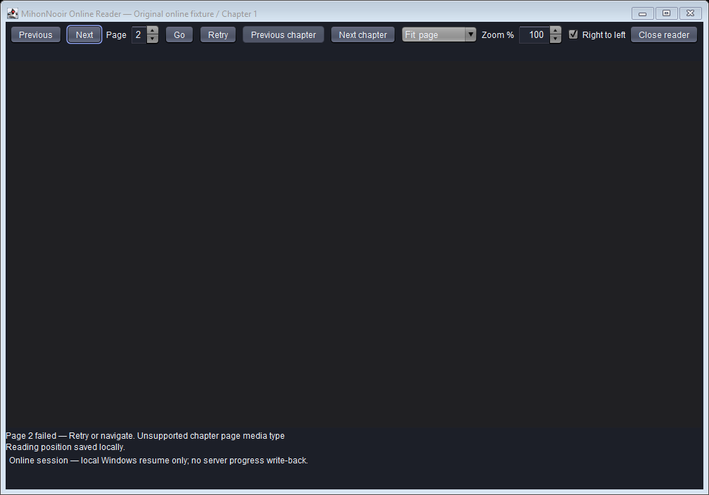

## Move your library between Android and desktop (development candidate)

1. In Android's More → Settings → Data and storage, create a normal Mihon-format backup with the library and desired reading metadata. Keep that original file, downloaded pages and any other data separately.
2. On desktop, open **Backup & restore → Inspect backup…** and choose the .tachibk file. Review record counts, source IDs and repositories before making changes.
3. Start/connect to the local Suwayomi server. Configure only repositories you independently trust in the local WebUI. Use **Review missing extensions…** for exact source matches; if a never-installed package lacks its source IDs, the development-only **Review downloaded repo index…** action accepts a trusted, locally obtained legacy index JSON for a matching configured repository. The local index is not signature-verified. Modern repository indexes and automatic registration are not implemented. Approve each proposed installation yourself.
4. Choose **Restore library…**, review the missing sources and confirm a separate, new recovery backup filename. Restore merges library metadata; server completion is not proof every record was restored. Recheck the library and sources afterward.
5. To move back to Android, save any desired desktop server reading positions explicitly, choose **Create portable backup…**, and copy the .tachibk file to your phone. The Android-compatible field layout and real Suwayomi round trip are tested; actual import on a physical Android device is still required. Keep the original phone backup, use Android's restore menu, and review missing extensions.

Do not assume the portable backup includes downloaded pages, APKs, credentials, local-only reading positions, Nooir settings, or web projects. Back up the desktop data folder separately. This section describes the development branch, not an already published desktop version. New screenshots for this workflow are pending. See [remaining screenshot coverage](SCREENSHOT_COVERAGE.md) and [migration engineering notes](BACKUP_MIGRATION.md).
