# MihonNooir Android v1.0.20 — visual walkthrough

This is the Android guide, separate from the desktop development preview. Install the [official signed v1.0.20 release](https://github.com/toshio2011/mihon-nooir/releases/tag/v1.0.20). The screenshots below are actual raw Android emulator captures from the release-source integration run [45352687891](https://github.com/toshio2011/mihon-nooir/actions/runs/45352687891), not screenshots of the signed APK or a personal device. The embedded files are permanent copies of the original capture PNGs. The exact [screenshot archive](https://github.com/toshio2011/mihon-nooir/actions/runs/45352687891/artifacts/14901798319) contains eight images and capture notes; Actions login and retention apply.

## First launch and local book conversion

These ten additional real emulator screenshots come from the same release-source integration run [45352687891](https://github.com/toshio2011/mihon-nooir/actions/runs/45352687891), [Universal Converter/device-smoke archive](https://github.com/toshio2011/mihon-nooir/actions/runs/45352687891/artifacts/14902042068). All content is synthetic. The capture notes confirm navigation, including two decoded pages of an actual finished XTCH. They do not depict the final signed APK.

### A. Finish first-run setup

Install the official APK using [Getting started](GETTING_STARTED.md). Choose your theme and tap **Next**. When asked for a storage folder, choose or create a dedicated app folder rather than the entire Downloads root, grant access, complete onboarding and tap **Get started**. This screenshot shows the theme step; folder creation and later onboarding screens are not pictured.

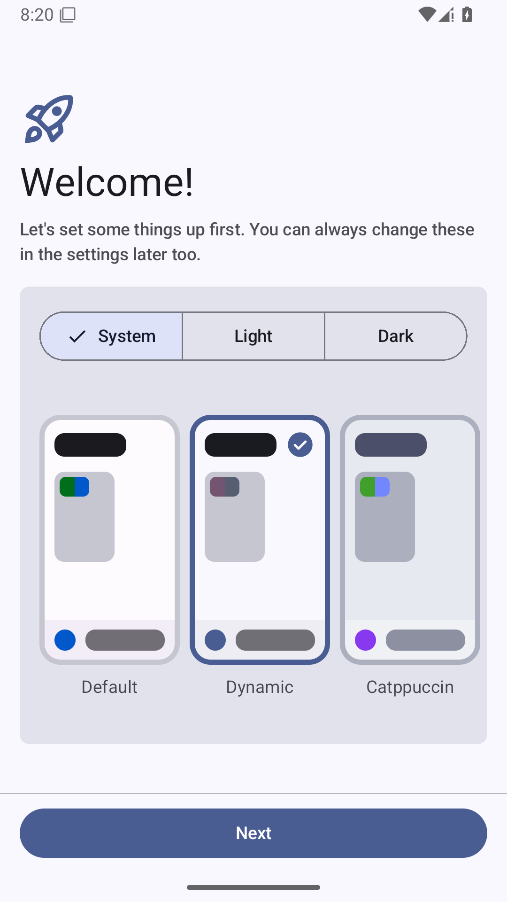

### B. Choose a converter

Open **More → Nooir Tools → Universal Book Converter**. Choose **Local files**, **Preview finished XTC / XTCH book**, or the dedicated **PDF files** converter; scroll for web options. The available routes depend on the selected source type.

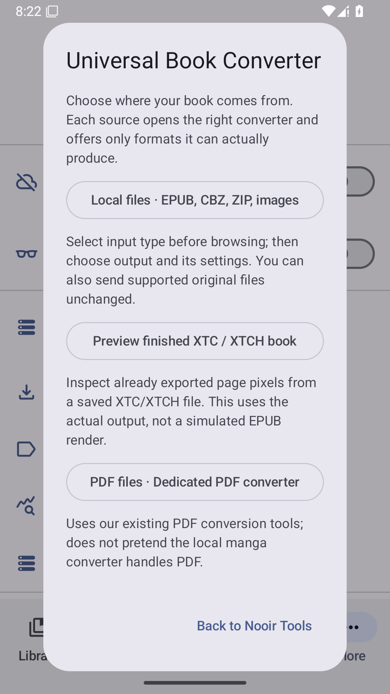

### C. Local EPUB, CBZ/ZIP or images

Select **Local files**. Choose the input type first so Android's file picker filters matching documents. Select **EPUB** then **Choose EPUB files**. Review device profile, output format and conversion settings after selecting a file; select the destination before starting. For EPUB to XTC/XTCH, choose the appropriate supported reader and typography settings. The captures show the selection screen before a file is picked, not a completed conversion.

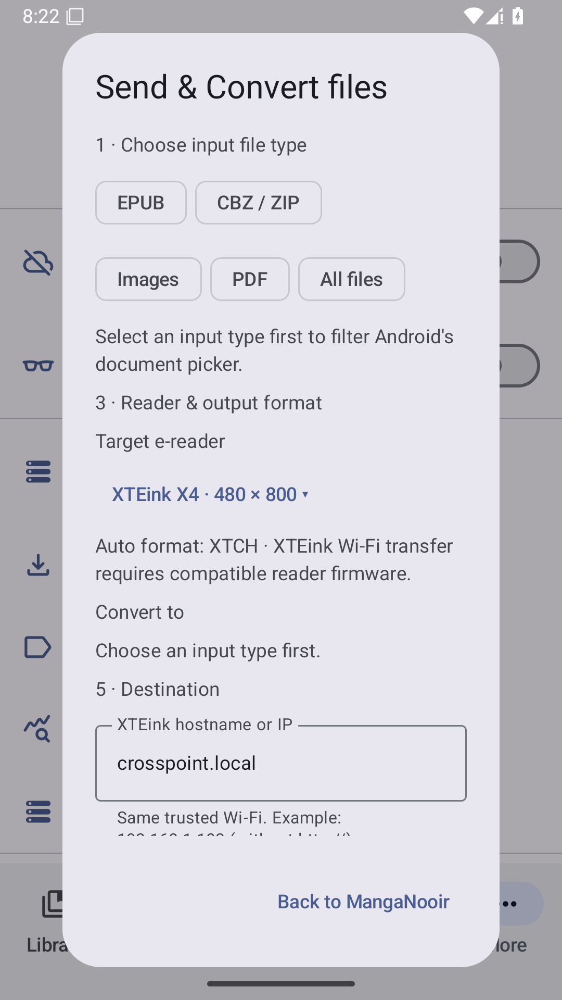

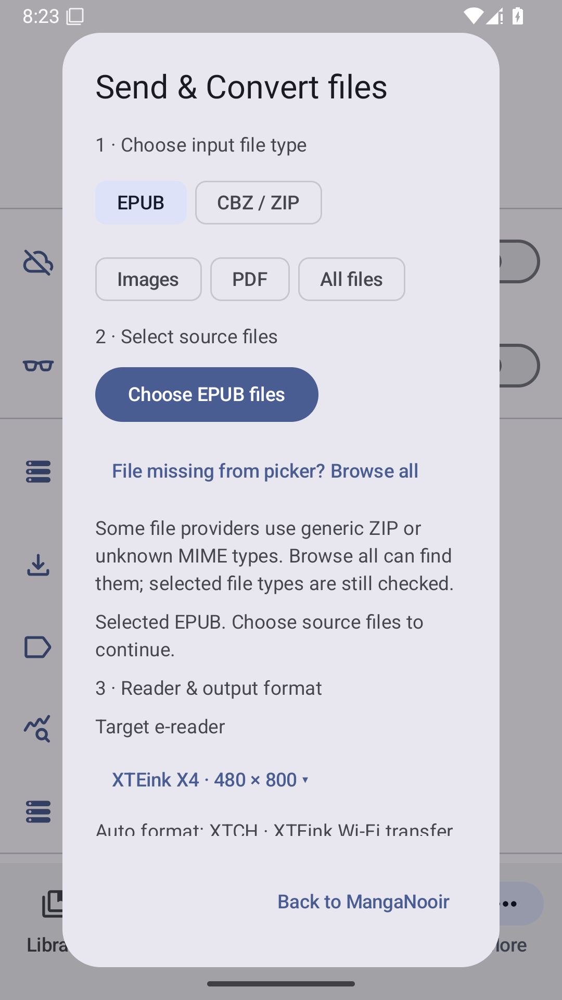

### D. Inspect a finished XTC/XTCH

Choose **Preview finished XTC / XTCH book → Choose finished XTC / XTCH book**. Pick your actual saved file in Android's file picker. Use First, Prev, Next or Last to inspect decoded output. This does not reconvert the file or send it to the reader. The synthetic fixture deliberately has a black square on page one and reflowed prose on page two.

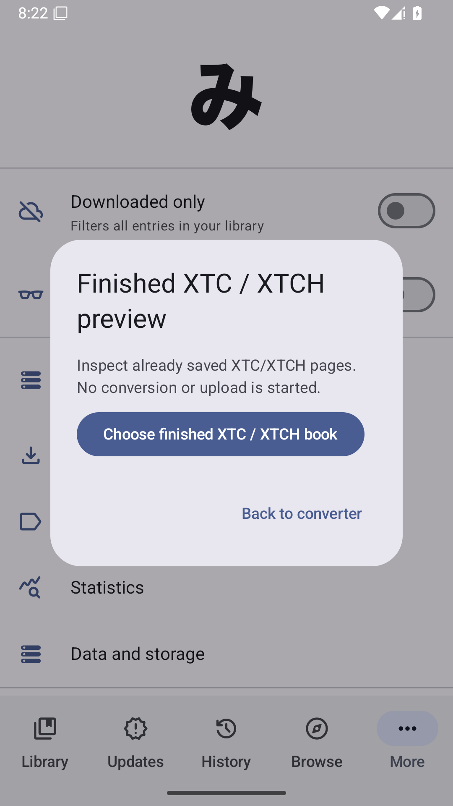

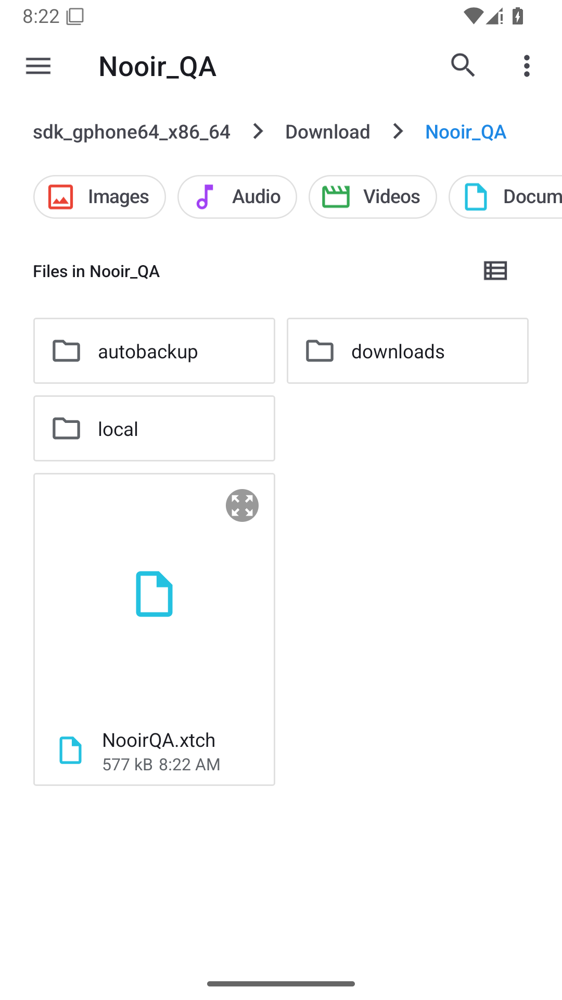

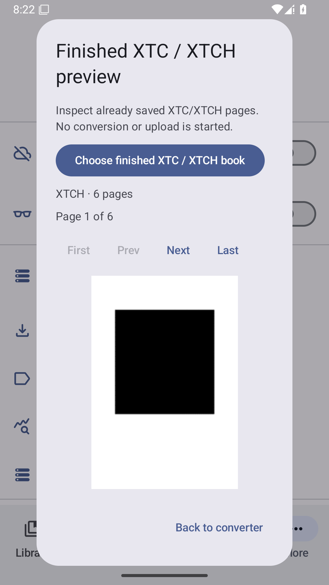

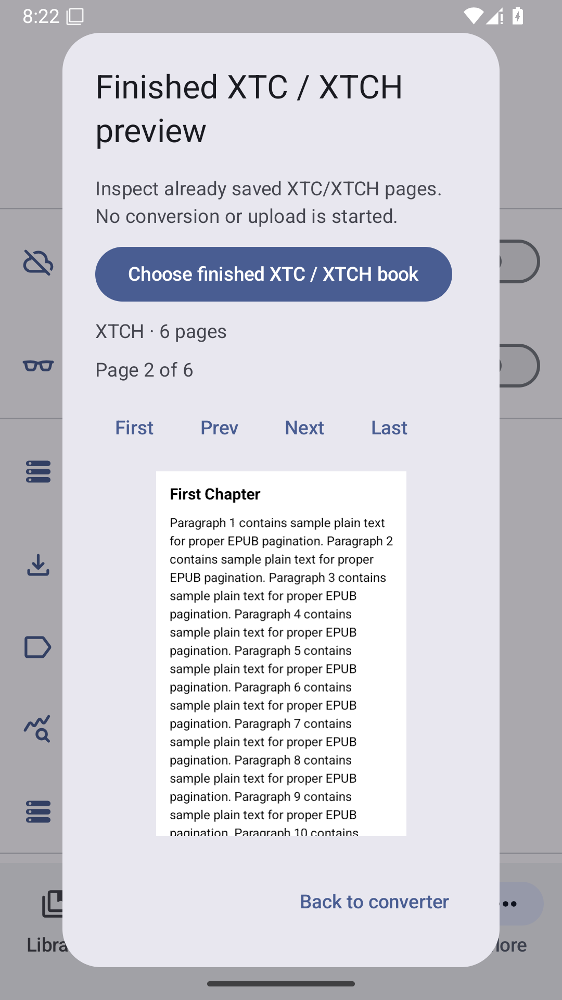

### E. Convert a PDF

Open **Universal Book Converter → PDF files**, or select **PDF** under Local files and tap **Open PDF converter**. Choose one or more PDFs, enter optional title/author and a new output name. Scroll to select EPUB2/3, XTC or XTCH, review applicable settings and save or send. Use original page mode if complex layouts do not reflow well. See the [PDF guide](PDF_TO_EPUB.md) for the different output modes and limitations. These screenshots show the actual pre-selection form, not a finished PDF conversion.

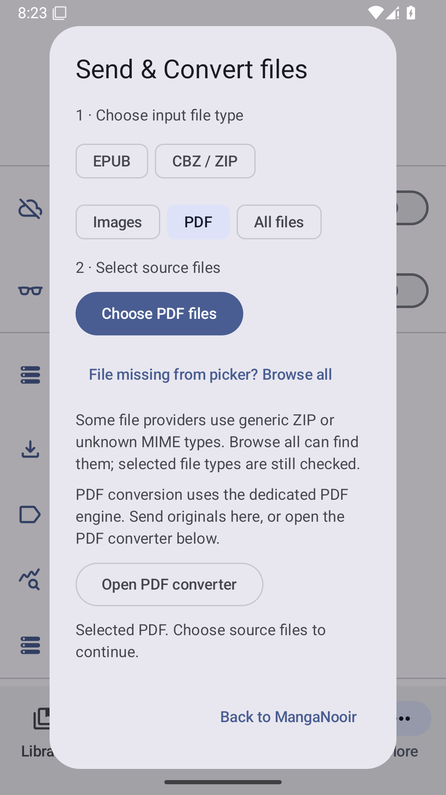

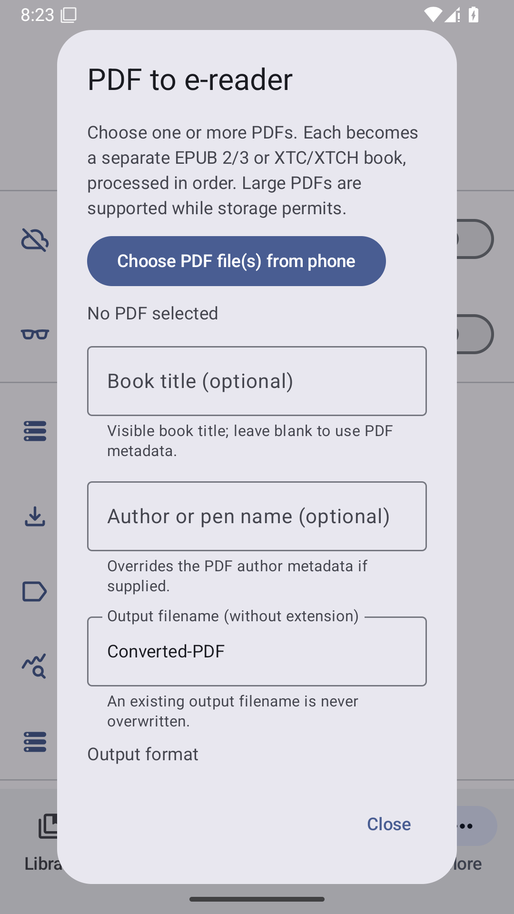

## 1. Find Nooir Tools

Open MihonNooir. Tap **More** (bottom-right) → **Nooir Tools** → **Universal Book Converter** → **Web novels**. The captured emulator followed these actual navigation labels. The library is deliberately empty in the test profile.

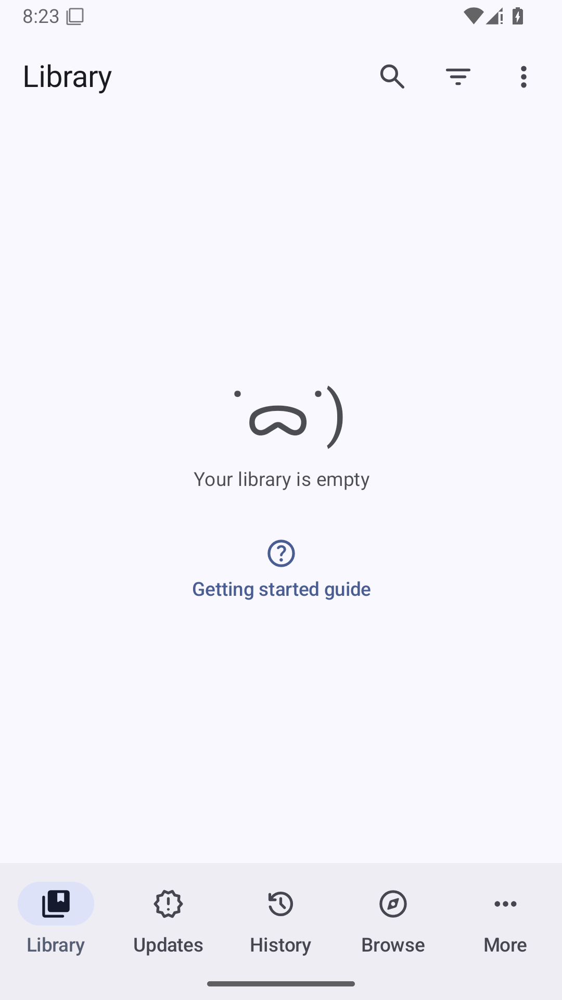

## 2. Create one EPUB per public story

Paste public HTTPS story URLs, one per line. With **Combine pasted webpages into ONE EPUB** unchecked, each story produces its own EPUB. The visible editor supports up to ten separate stories per batch. For a story overview, use **Analyze chapters before export** where available and review chapter titles, cover and synopsis before choosing selected chapters. The captures show the initial editor, not a completed chapter analysis.

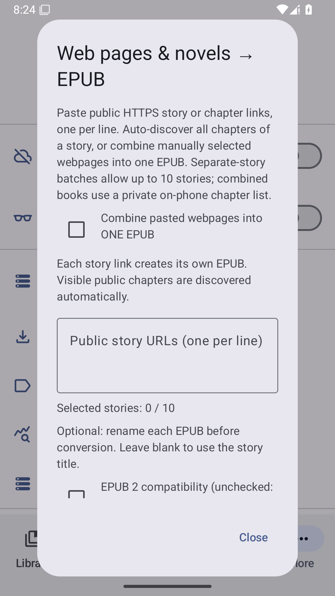

## 3. Combine public chapters into one book

Check **Combine pasted webpages into ONE EPUB**. Paste direct readable chapter/page URLs in the intended reading order, one per line. The editor shows selected chapter count and a 128 KiB URL-list budget; there is no fixed chapter count in this mode. Each URL becomes one chapter. Reorder the URL lines before exporting.

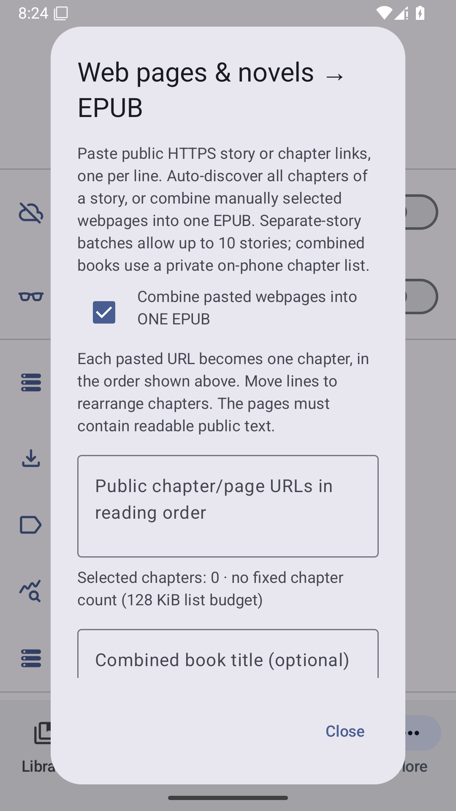

## 4. Book details and covers

Scroll down to set combined book title, author, language (for example en or ms), description and **Cover options · auto-detect source cover**. Choose a supported cover when needed. Public Wattpad metadata can populate the title, cover, author and synopsis; only readable public chapters are supported. Specify a new combined EPUB filename without .epub.

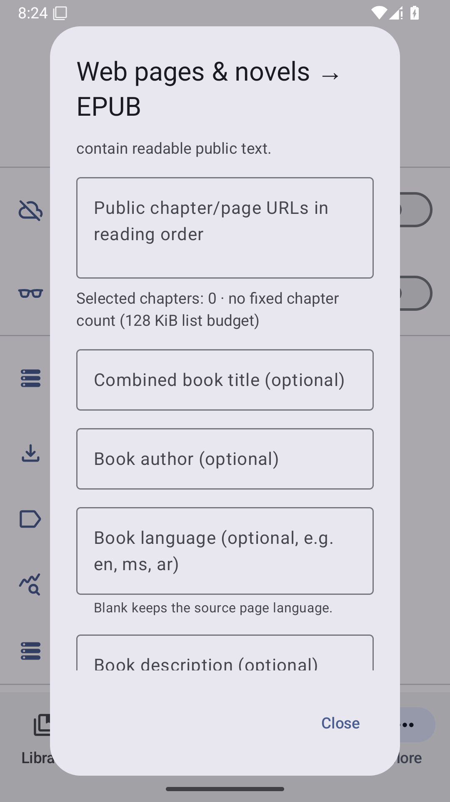

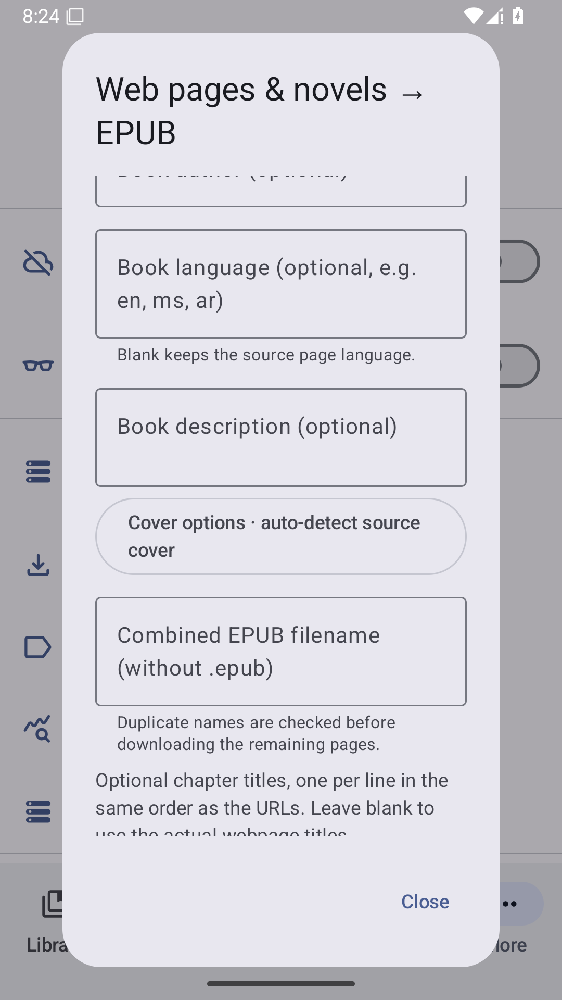

## 5. Chapter titles and saved projects

Optionally enter chapter titles in the same line order as the URLs. Enter a project name and save a completed setup to reuse later. Use **Check new chapters** for a saved project as appropriate. Projects are on this phone, not cloud-synced. The screenshot shows the buttons disabled before a valid setup is supplied.

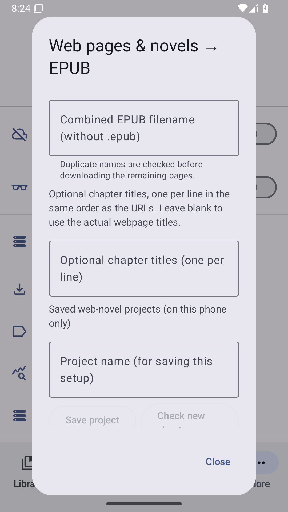

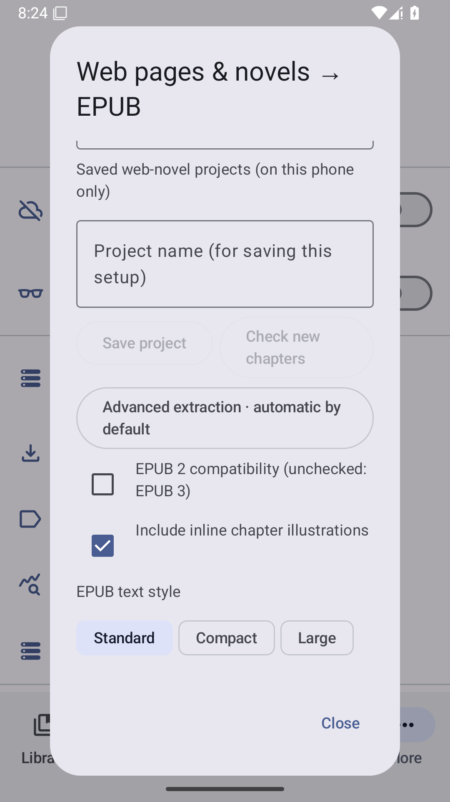

## 6. EPUB compatibility and reading style

Leave **EPUB 2 compatibility** unchecked for EPUB3, or enable it for EPUB2. Choose whether to include inline illustrations, select Standard, Compact or Large EPUB text style, and use the optional safe custom EPUB text CSS only if needed. Scroll for illustration size and the save/send action. Choose a new output filename, inspect the resulting book, and use the [Wi-Fi transfer guide](WIFI_TRANSFER.md) if your reader supports it.

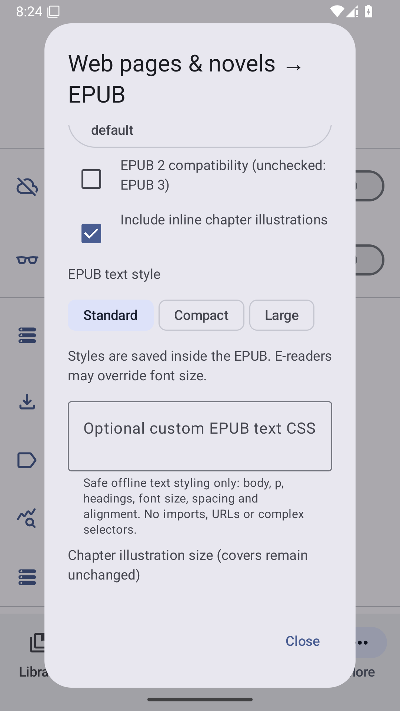

## More Android walkthroughs

The existing [Getting started](GETTING_STARTED.md), [Nooir Tools](NOOIR_TOOLS_QUICK_START.md), [Manga conversion](CONVERSION.md), [PDF](PDF_TO_EPUB.md), [Web novels](WEB_NOVELS.md), [Wi-Fi transfer](WIFI_TRANSFER.md) and [FAQ](FAQ.md) guides remain available. First launch, local input selection, actual XTCH viewer and initial PDF form are now pictured using the release-source QA build. Further captures are needed for full onboarding, extension repository setup, manga selection and export settings, PDF settings and completed output, transfers, backup/restore and other menus. Final signed-APK verification remains separate. No personal backups, manga library or credentials should appear in documentation. Android/Desktop backup migration is still in development; this guide does not promise it in v1.0.20.
