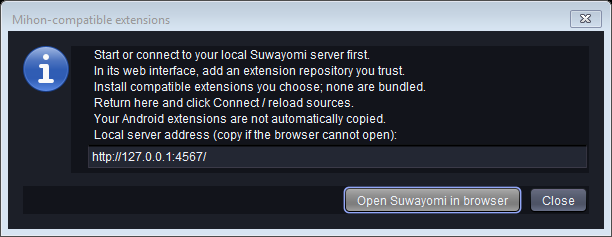
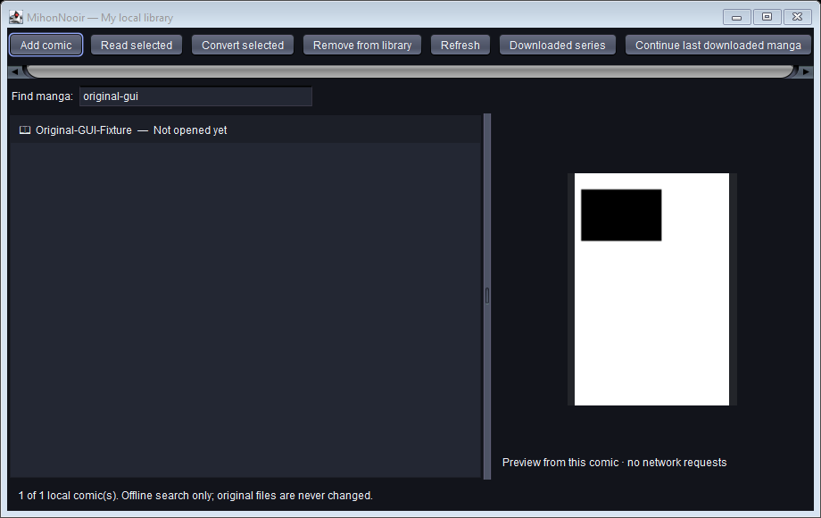
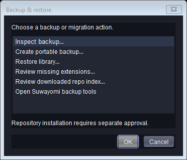
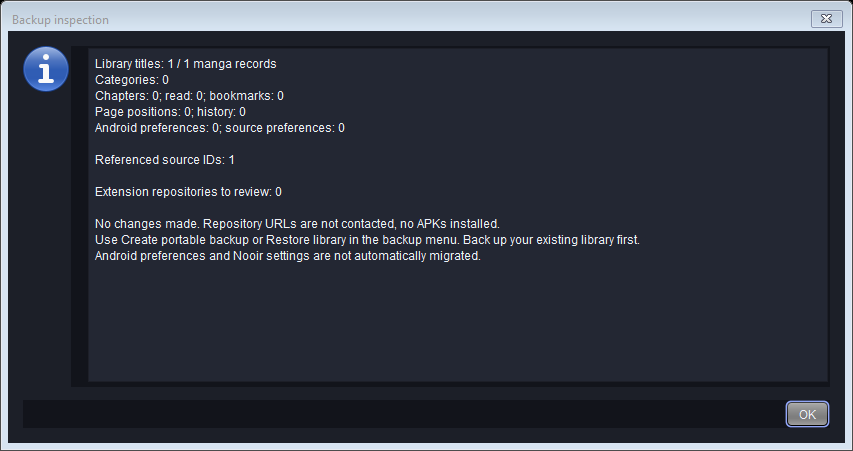
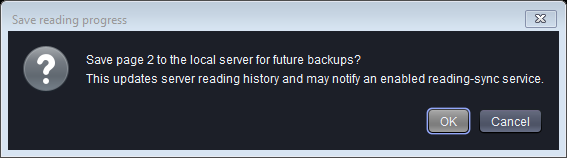
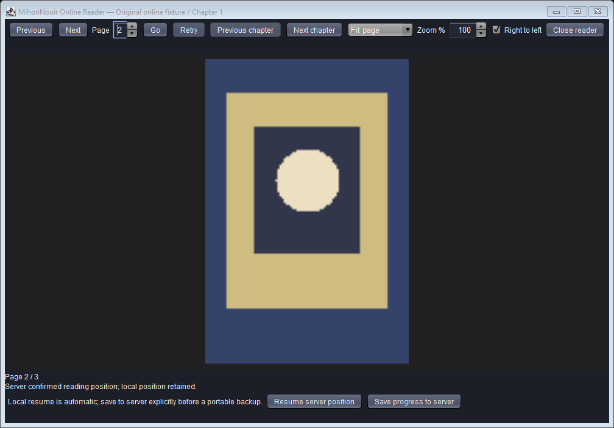

# Library, extensions, backup and transfer — visual guide

[All guides](README.md) · [Android visual guide](ANDROID_VISUAL_GUIDE.md) · [Universal Converter](UNIVERSAL_CONVERTER_VISUAL_GUIDE.md)

Android v1.0.20 is the official release. The desktop application shown below is a **development preview**, not a released desktop product. Desktop screenshots are reused byte-for-byte from the existing Windows QA captures, not new screenshots or Android screens. Actual third-party extension recovery and physical Android migration remain acceptance gates.

## Get started with extensions and your library

### Android

Complete first-run setup, then use Browse to manage compatible source extensions and find a manga. No extensions or manga are bundled. Install only extensions and repositories you independently trust; Android installation and repository approval are separate from importing a library backup. Open a manga, add it to your library and choose a chapter. See [Getting started](GETTING_STARTED.md) and [chapter selection](CHAPTER_SELECTION.md). Android extension installation and library screenshots are still pending.

### Desktop preview

Start or connect to a compatible local Suwayomi server for online sources. Open **Manage extensions**, then **Open Suwayomi in browser**. Configure a trusted repository and install compatible extensions in the local WebUI. Return to the desktop app and reconnect. Local reading and conversion do not require a server.

For books already on your computer, open the Local library and import a supported comic or image folder.

These two screens are Windows QA captures from the integrated candidate `7ff39e90bc5f2372ee1ca004e27c24bbb68e2ff7`. They show the setup entry point and library, not a completed third-party extension installation.

## What does a backup include?

A Mihon-format backup can record library entries, categories, chapters, bookmarks, read status, reading positions, history and source/repository metadata, depending on the app and selected backup options. Keep downloaded pages and other files separately. Desktop portable backup exports library and configured extension-store metadata; it does **not** include APKs or Nooir settings. Do not assume credentials, source preferences, local-only reader progress or web projects migrate.

## Android to desktop (preview)

1. In Android, open **More → Settings → Data and storage** and create a backup with the desired library and reading records. Keep the original `.tachibk` and separate copies of important downloads. Do not uninstall or clear app storage.
2. On desktop, open **Backup & restore**, choose **Inspect backup…**, and select the backup. This read-only operation does not contact repository URLs or install packages.

| Backup menu | Read-only inspection |
|---|---|
|  |  |

3. Review the counts, referenced source IDs and repositories. Connect to the intended local Suwayomi server before any write operation.
4. Use **Review missing extensions…** to inspect exact source-ID matches. Add only independently trusted repositories manually in the local WebUI. For an already configured matching legacy repository, **Review downloaded repo index…** can use a user-obtained local legacy index JSON; it is not cryptographically verified. Modern index support and automatic registration are not implemented. Approve each proposed extension installation separately; never install a package solely because a backup lists it.
5. Choose **Restore library…**, select the backup, review missing sources and trackers, and approve the merge. Select a separate new recovery backup filename when prompted. Existing categories and progress can change. Server settings and extension installation are excluded from the restore.
6. Check the server status and the actual library, category membership, reading records and source availability. Even SUCCESS can contain individual record failures. If status is unknown or failed, inspect the WebUI before retrying; partial changes may exist.

Steps 3–6 still need completed visual captures. Do not infer a successful restore from the inspection image.

## Desktop to Android (preview)

1. In the desktop online reader, display the desired page and explicitly choose **Save progress to server**. Confirm the action. Local resume positions alone are not guaranteed to appear in the portable backup; the operation refuses known newer server positions and does not automatically mark chapters read.

| Confirm progress write | Server acknowledgement |
|---|---|
|  |  |

2. In **Backup & restore**, choose **Create portable backup…** and select a new `.tachibk` filename. Keep the desktop data directory separately.
3. Copy the backup to the phone. First create and retain a fresh backup of the Android library. Use Android's restore action in Data and storage, review selected restore options and check missing sources.
4. Validate the restored library, categories, reading positions and available extensions. Do not delete either original backup or downloaded content during acceptance.

**Status:** real pinned Suwayomi integration and native desktop acceptance passed in [run 45751778633](https://github.com/toshio2011/mihon-nooir/actions/runs/45751778633), including Intel Mac. The four backup/progress screens above came from Windows QA run [45744401559](https://github.com/toshio2011/mihon-nooir/actions/runs/45744401559), using synthetic backup and localhost content. Physical Android restore and real third-party extension compatibility remain unverified. No release approval is implied. See the [desktop migration notes](https://github.com/toshio2011/mihon-nooir/blob/c2385938f9877869a1ff6afb465dbc73c3e7fd52/desktop/BACKUP_MIGRATION.md).

## Transfer a converted book to an e-reader

For a compatible Folio Nooir reader, enable **File Transfer** and connect the phone/computer and reader on a trusted local network or reader hotspot. Confirm the reader's displayed address. The server is unencrypted; turn it off when finished.

- Android: choose **Send to XTEink** in the manga export or relevant converter; enter only the reader's IP/hostname, an existing folder and a new filename. See [Wi-Fi transfer](WIFI_TRANSFER.md).
- Desktop preview: use the reader transfer tool, select an existing saved book, then fill **Reader private IPv4**, **Existing folder** and **Destination filename**. Review the confirmation and wait for the reader to confirm the upload and size. Desktop requires a private IPv4 address.
- For large files or unsupported Wi-Fi workflows, save locally and copy using the reader's supported USB or SD-card method.

100% sent is not reader acknowledgement or proof that the reader can open the format. Check the saved book on the reader. On errors, inspect the destination for a partial file before retrying. Avoid concurrent sends to the same filename.

## Manage conversion jobs

Android **More → Nooir Tools → Activity Queue** shows current and historical jobs. The confirmed cancellation action stops the whole Nooir queue; it is separate from Mihon's chapter download queue.

Desktop preview **Conversion jobs** provides **Add local books**, **Run / recover**, **Pause after current**, **Retry selected**, **Cancel selected**, **Clear finished** and **Refresh**. Clearing finished records leaves output files unchanged. Match the input category to the file, then choose compatible output and device settings. Keep original files.

Transfer, queue, successful restore, extension approval and physical Android migration screens are pending. These steps are text instructions based on existing guides and the inspected candidate implementation, not newly captured UI evidence.

## Final acceptance checkpoint — 26 November 2026

Use the exact unsigned desktop candidate `c2385938f9877869a1ff6afb465dbc73c3e7fd52` from [run 45751778633](https://github.com/toshio2011/mihon-nooir/actions/runs/45751778633). All nine desktop jobs passed. The Intel Mac and Windows real-server logs explicitly report the synthetic Android-format backup validation, recovery backup, restore/export, missing signed source, repeated import, explicit page write-back and rewind refusal. The previously intermittent Intel Mac failure remains a reliability follow-up, not a proven root-cause fix.

| Test package | CI artifact |
|---|---|
| Windows x64 (unsigned preview) | [15086591798](https://github.com/toshio2011/mihon-nooir/actions/runs/45751778633/artifacts/15086591798) |
| Windows ARM64 | [15085709927](https://github.com/toshio2011/mihon-nooir/actions/runs/45751778633/artifacts/15085709927) |
| macOS Intel | [15086217450](https://github.com/toshio2011/mihon-nooir/actions/runs/45751778633/artifacts/15086217450) |
| macOS Apple Silicon | [15086278083](https://github.com/toshio2011/mihon-nooir/actions/runs/45751778633/artifacts/15086278083) |
| Linux x64 | [15086487826](https://github.com/toshio2011/mihon-nooir/actions/runs/45751778633/artifacts/15086487826) |
| Linux ARM64 | [15085634683](https://github.com/toshio2011/mihon-nooir/actions/runs/45751778633/artifacts/15085634683) |

These artifacts are temporary development downloads, may require GitHub login, and are not signed public releases. Verify the package identity and checksums before execution. Do not bypass OS security warnings. Test with an isolated desktop data directory and an independently backed-up Android test profile. Do not restore a test backup into a primary library.

### Physical acceptance record (all pending unless independently verified)

| Case | Required result |
|---|---|
| Launch portable candidate on a real computer | Opens offline, navigation reachable, no existing profile altered |
| Authorized local CBZ/EPUB/PDF | Read, convert and inspect saved output; source checksums unchanged |
| Trusted compatible extension | Explicit repository/package approval; source ID and version match; browse, read and export an authorized chapter |
| Android → desktop | Record original category order/membership, read flags, bookmarks, exact page positions and history; restore with a separate recovery copy and compare |
| Repeat desktop restore | No duplicate titles/categories; preserve expected state; record exact server ticket/status and logs on failure; no automatic retry |
| Desktop → Android | Explicitly save server progress, create portable backup, import on a test phone/profile and compare exact records, then reopen |
| XTEink transfer | Send a uniquely named small book over a trusted LAN, verify acknowledgement, size and actual reader opens/pages; check duplicate refusal without overwriting |
| Native install/update | Verify profile retention, architecture, OS trust/signing and platform-specific installation/upgrade behavior |

Record candidate SHA, package/OS/architecture, Android app version, firmware/device, actual and expected results, and any failure details. Use synthetic or authorized material; keep personal backups, source credentials, IP addresses and private reading history out of public evidence. Physical Android restore, third-party extension compatibility, physical hardware and production signing remain open. Automated CI success is not a substitute for these checks.

## Windows field-test follow-up

A tester reported that extension repository access initially failed with Java SSLHandshakeException / PKIX certification-path errors. A process-scoped Windows certificate-store workaround was suggested; the tester subsequently reported working manual extension setup and successful XTC export on the desktop preview. The exact repository, network conditions, certificate chain and restored-library record equality have not been independently verified. Do not treat this as a universal certificate fix or a completed migration.

Remaining acceptance: diagnose the bundled runtime trust configuration, provide a secure supported solution without disabling TLS verification, and improve reviewed recovery of missing compatible extensions, including modern repository formats. Manual installation remains the available fallback. Keep original backups and verify library records separately.

## Screenshot provenance

The six PNGs in this guide are exact copies of already committed desktop QA screenshots: [source tree at c2385938](https://github.com/toshio2011/mihon-nooir/tree/c2385938f9877869a1ff6afb465dbc73c3e7fd52/desktop/screenshots). No private library, backup, network address or login credentials were added.
