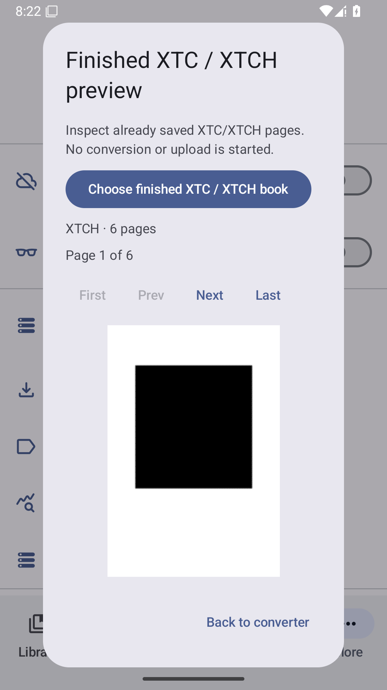
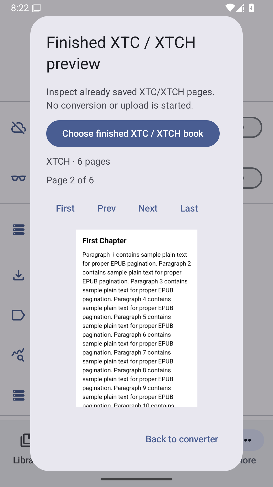

# Manga export and conversion gallery

[All user guides](README.md) · [Choose chapters](CHAPTER_SELECTION.md) · [Conversion settings](CONVERSION.md) · [Auto Fit](PANEL_AUTO_FIT.md)

This evergreen guide explains how to export manga and compare conversion choices. The linked Android captures are release-source emulator evidence, not signed-APK or physical-reader captures. Desktop is a development preview. The comparison gallery below is a capture backlog, not a claim that the comparison images already exist.

## Export manga on Android

1. Open the manga details page, long-press a chapter and tap additional chapters to select them.
2. Tap the Export toolbar action. Normal Export uses downloaded chapters; Quick Export can fetch selected missing chapters from a compatible online source. If no chapters are selected, Normal Export uses all downloaded chapters.
3. Choose the reader profile and output format independently.
4. Expand **More conversion settings** and choose **Apply recommended manga panel settings** for Japanese manga.
5. Check the segmentation, orientation, reading direction and enlargement settings. Preview the first page; disable **Keep first page of each chapter whole** for a sample intended to demonstrate splitting.
6. Save the output to a new local file. For large exports, copy the saved book to SD/USB where supported instead of sending a large single file over Wi-Fi.
7. Open **More → Nooir Tools → Universal Book Converter → Preview finished XTC / XTCH book** and inspect the actual saved file.

See [chapter selection and Quick Export](CHAPTER_SELECTION.md) and [transfer instructions](WIFI_TRANSFER.md). The chapter-selection and export dialog screenshots are still pending.

## Recommended starting point for XTEink

| Setting | Starting point |
|---|---|
| Reader | Matching device profile; X4 480×800, X3 528×792 |
| Format | XTC for monochrome, XTCH for four gray levels |
| Layout | Pages |
| Segmentation | Panel by Panel |
| Orientation | Auto Fit |
| Direction | Right to left for Japanese manga |
| Ordinary overlapping page cuts | 0% for recommended panel preset |
| Enlarge oversized splits | On |
| Minimum screen fill | 50% |
| Context Peek | Off |
| Full-page overview | Optional; preset off |

The preset retains some earlier preferences, so check them explicitly. The detector is heuristic; uncertain artwork can stay together. Eligible oversized views may use a separate 12% protective overlap even with ordinary overlap at 0%. Auto Fit does not stretch or crop art to fill the screen. For native XTC/XTCH, turn the reader physically sideways for rotated wide views.

## Existing actual output evidence

The two images below show decoded pages of a finished synthetic XTCH in the Android release-source emulator. They demonstrate saved-file inspection, **not** manga panel detection or an XTC/XTCH quality comparison.

| Actual saved XTCH: image page | Actual saved XTCH: text page |
|---|---|
|  |  |

[Capture provenance and viewer walkthrough](ANDROID_VISUAL_GUIDE.md#d-inspect-a-finished-xtcxtch).

## Actual XTC and XTCH rendering comparison (desktop QA)

[Download the actual four-style comparison and original source image](https://github.com/toshio2011/mihon-nooir/actions/runs/45744401559/artifacts/15082563759) (GitHub sign-in and artifact retention apply). The archive contains `Nooir_Visual_4Modes_XTC_XTCH.png` and `Nooir_Visual_Source_Synthetic.png`. These were retrieved and visually reviewed; they use synthetic gradients, screentones, line art and dialogue, not copyrighted scans.

The [desktop rendering QA test](https://github.com/toshio2011/mihon-nooir/blob/desktop/final-acceptance-20261126/tests/DesktopVisualRenderingPreviewTest.kt) converts the same source into eight actual saved XTC/XTCH books, decodes each with `XtcBookPreview`, verifies native X4 480×800 dimensions and valid grayscale levels, then builds a half-scale contact sheet. Settings hold panel mode off, layout Pages, cover/trim/spread splitting off and neutral contrast. Only format and rendering algorithm vary. This is desktop converter evidence, not proof of Android raster parity or physical e-reader appearance.

| Style | What to look for |
|---|---|
| Floyd–Steinberg | Fine textured gradients and screentones |
| Atkinson | Lighter highlights and clear linework |
| Bayer 8×8 | Regular ordered dot pattern |
| Threshold | Hard tonal bands, with more levels in XTCH |

The original archived PNGs are not yet embedded permanently in the repository. The artifact link is existing evidence; permanent publication and full-resolution per-frame examples remain pending.

## Verified manga segmentation and orientation exports (desktop QA package, 26 November 2026)

The published development desktop JVM package from [CI run 45744401559, artifact 15083466467](https://github.com/toshio2011/mihon-nooir/actions/runs/45744401559/artifacts/15083466467) was downloaded and executed locally against an original synthetic six-panel robot comic. The source has numbered dialogue in right-to-left order. These are fresh actual saved XTC conversions, not an inference from the older regression tests or mockups.

| Settings | Actual saved frames |
|---|---:|
| Page, Portrait | 1 |
| Row by Row, Portrait | 3 |
| Panel by Panel, Portrait | 6 |
| Row by Row, Landscape | 3 |
| Row by Row, Auto Fit | 3 |
| Panel by Panel, Auto Fit | 6 |
| Panel by Panel, Portrait, full-page overview enabled | 7 |

All decoded frames are native X4 480 × 800 XTC. The six panel images were visually reviewed in reading order (1–6); some thin adjacent border lines are visible when trimming is off. Auto Fit and Landscape produced pixel-identical frames for all three wide rows. The overview was pixel-identical to the standalone Page export, and the six following frames matched the standalone Panel export pixel-for-pixel.

Controlled settings: Pages layout, X4, XTC, right-to-left, Atkinson, neutral contrast 50, ordinary overlap 0%, Context Peek 0%, trim/spread/cover/first-page protection/enlargement off; orientation, segmentation and overview changed only for the listed comparisons. Source SHA-256: `5d8efdb3634e02a0271c5dc2c5410cbd3ef0f40c84224bb17b8773ae5098f959`.

The original comic, seven saved XTC files, full decoded PNG sequences, comparison sheets, source generator, conversion harness, log and checksum manifest were produced in the local QA session. Permanent binary image publication in this repository is pending. The results above are documented now, but the illustrated gallery is not complete until the actual PNGs are committed and reviewed. These tests do not establish Android or physical reader parity.

## Advanced conversion comparisons (desktop QA, 26 November 2026)

The same [desktop JVM artifact](https://github.com/toshio2011/mihon-nooir/actions/runs/45744401559/artifacts/15083466467) was run against synthetic scroll, oversized-row, double-page spread and panel fixtures. Each result was exported as XTC and decoded through XtcBookPreview at native X4 480 × 800. Only the setting under comparison was changed within each pair.

| Comparison | Actual result | What it means |
|---|---|---|
| Webtoon, Portrait, overlap 0% vs 10% | 3 vs 3 frames; first frame identical, later frames different | 10% repeats visible content at the next slice boundary; count may vary by source |
| Row by Row, Landscape, enlargement off vs on, minimum fill 50% | 2 vs 3 frames | Oversized test tier becomes two larger views; ordinary overlap remains 0% |
| Split double-page spread, RTL vs LTR | 2 vs 2 frames | Exact same decoded frames in reverse order; RTL emits right half first |
| Context Peek 0% vs 4%, original six-panel comic | 6 vs 6 frames; all pixels identical | No visible effect on this fixture |
| Context Peek 0% vs 8%, close two-panel fixture | 2 vs 2 frames; all pixels identical | Still no visible effect; a positive end-to-end example remains pending |

Context Peek is conditional, not a guaranteed zoom or split. The [desktop converter implementation](https://github.com/toshio2011/mihon-nooir/blob/desktop/final-acceptance-20261126/desktop/cli/NooirDesktopCli.kt) only expands adjacent confirmed, unprotected panels when the final slice count matches the detector count and the gap is eligible. The unchanged results alone do not establish a defect or prove that the feature works end to end. Do not advertise a visible before/after effect until a suitable fixture demonstrates it.

The generated comparison sheets and decoded sequences were inspected in the local QA session. Permanent image publication remains pending; the results are desktop evidence, not signed Android or physical-reader verification.

## Compare actual manga results

The planned comparison gallery uses the same legally shareable source page in each pair or sequence. Keep the reader profile and all unrelated settings constant; show every generated view in reading order, including the full-page original. Do not substitute live-preview thumbnails, synthetic checkerboards or diagrams for actual decoded manga output.

| Comparison | What to inspect | Capture status |
|---|---|---|
| Page vs Row by Row vs Panel by Panel | View count, reading order, scale and grouped columns | Desktop XTC 1/3/6 verified; permanent images and Android pending |
| Portrait vs Landscape vs Auto Fit | Fitted occupancy, rotation and white margins | Desktop XTC row comparison verified; permanent images and Android pending |
| Ordinary overlap 0% vs 10% | Repeated area and continuity on long strips | Desktop Webtoon XTC verified; permanent images and Android pending |
| Enlargement off vs on, minimum fill 50% | Natural boundaries or guarded overlap on oversized views | Desktop XTC 2/3 verified; permanent images and Android pending |
| Context Peek off vs 4% | Adjacent confirmed panel context | Six-panel and close two-panel outputs unchanged; positive example pending |
| Full-page overview off vs on | Original overview followed by detail views | Desktop XTC 6/7 verified, exact overview/frame equality; permanent images and Android pending |
| Keep first chapter page whole off vs on | Independent protection of opening artwork | Pending |
| XTC vs XTCH | Decoded monochrome vs four-level gray on same artwork | Desktop synthetic comparison reviewed; manga and Android examples pending |
| Floyd–Steinberg, Atkinson, Bayer 8×8, Threshold | Line art, shading and dithering texture | Desktop synthetic comparison reviewed; full-resolution manga examples pending |
| Right-to-left vs left-to-right spread split | Reading order of facing pages | Desktop XTC exact reverse verified; permanent images and Android pending |

## Capture and publication checklist

- Use original or explicitly licensed artwork with ordinary grid, wide/oversized, sparse, continuous long-strip, diagonal and double-page examples. Record creator, license and source checksum. Never include a private library or commercially distributed manga without permission.
- Capture real Android and desktop screens with a clean fixture library. Record platform, app version/commit, build type, test run, source page ID, profile and complete conversion settings.
- Export actual books through each platform's conversion path. Decode the finished XTC/XTCH files and preserve the full frame sequence. For EPUB/CBZ examples, inspect actual packaged images and navigation. Record output filename, SHA-256, frame count and dimensions.
- Keep source and exported frame images lossless; present annotated copies separately from unmodified captures. Label rotation and any repeated region. Show failures or limitations honestly.
- Verify reading order, no missing content at splits, dimensions, output opens successfully and comparison settings differ only as intended. Record physical-reader verification separately from emulator/desktop evidence.
- Keep image paths stable, add descriptive alt text and captions, and update affected examples when behavior changes. Do not publish a completed-comparison label until the corresponding files have been captured and checked.

## Other workflows

[Android visual guide and coverage](ANDROID_VISUAL_GUIDE.md) · [Local files and queue](NOOIR_TOOLS_QUICK_START.md) · [PDF](PDF_TO_EPUB.md) · [Web novels](WEB_NOVELS.md) · [Troubleshooting](FAQ.md)

For the desktop development preview, see its [separate user guide](https://github.com/toshio2011/mihon-nooir/blob/desktop/final-acceptance-20261126/desktop/DESKTOP_GUIDE.md). Android and desktop can differ in UI, raster rendering and migration support; do not claim parity from shared geometry alone.
