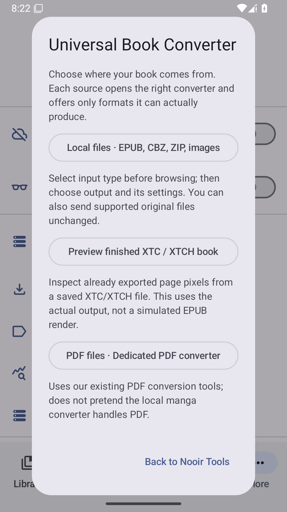
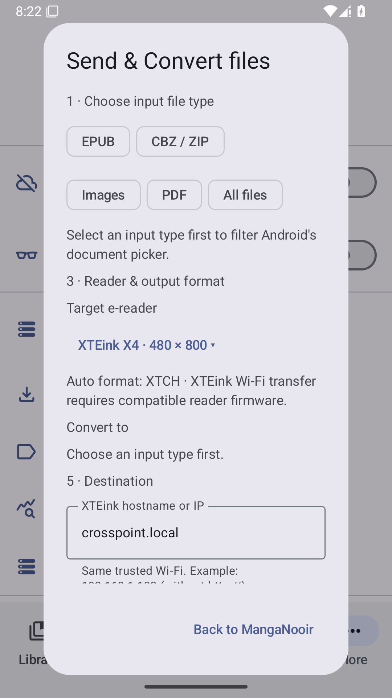
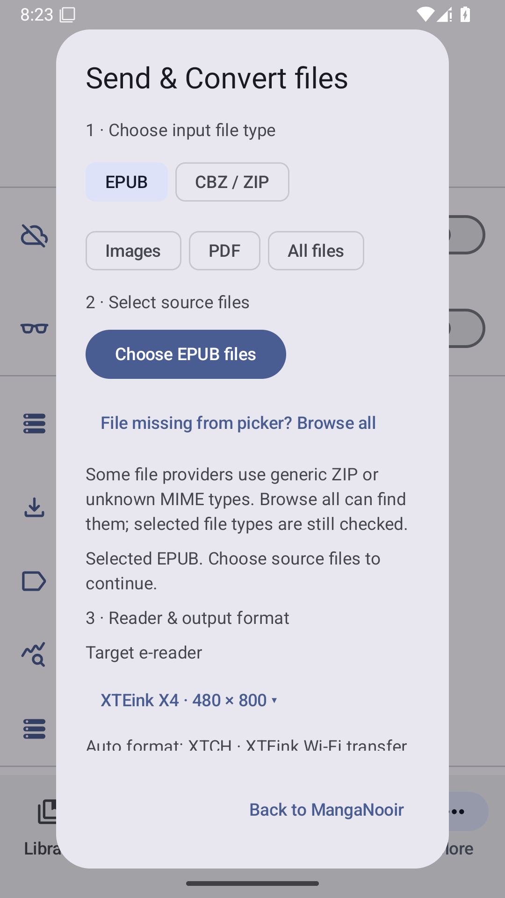
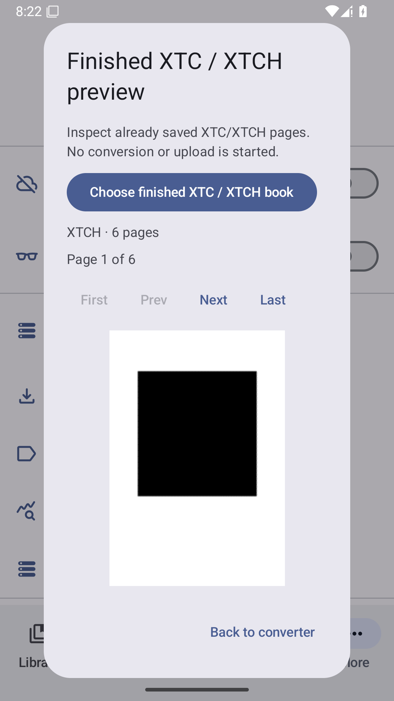
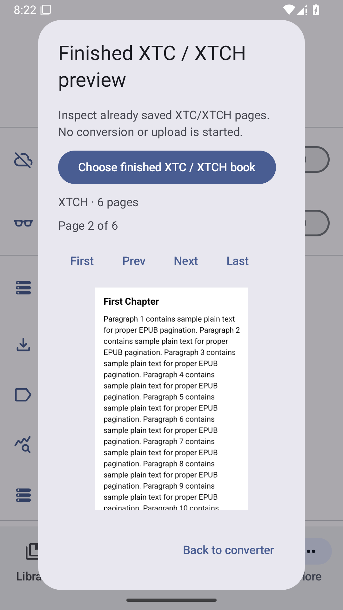
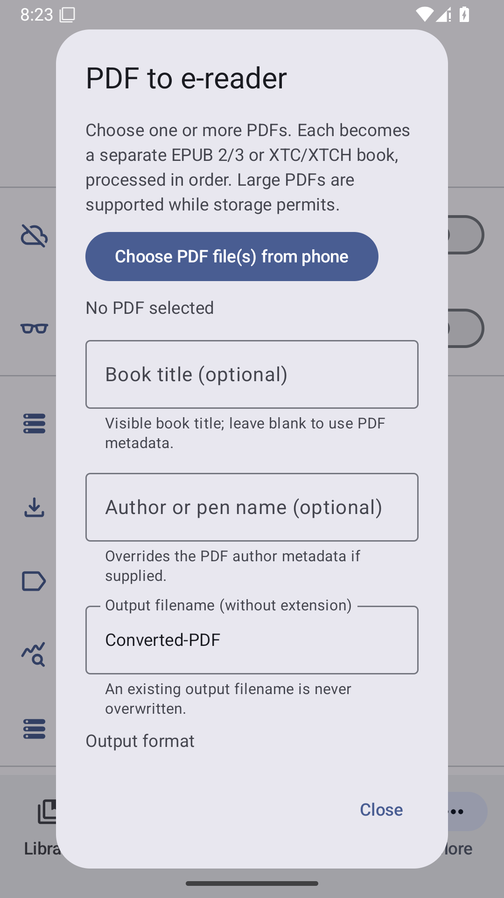
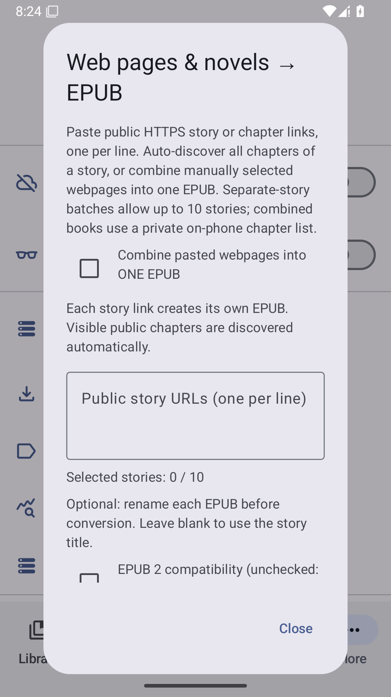
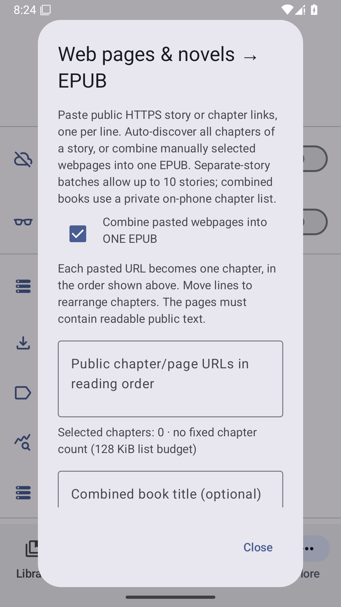
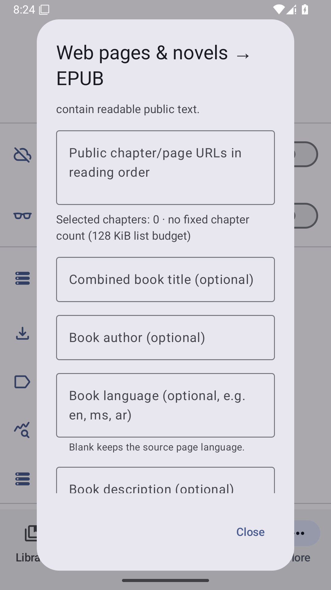

# Universal Book Converter — visual walkthrough

[All guides](README.md) · [Android visual guide](ANDROID_VISUAL_GUIDE.md) · [Manga export gallery](MANGA_EXPORT_GALLERY.md)

This task-based guide covers Android. Desktop remains a [development preview](https://github.com/toshio2011/mihon-nooir/blob/desktop/final-acceptance-20261126/desktop/DESKTOP_GUIDE.md#universal-book-converter). Screens below are genuine v1.0.20 release-source emulator captures, not signed-APK or physical-reader screenshots. Screens show input selection; completed-output evidence is identified separately.

## Choose the right converter

Open **More → Nooir Tools → Universal Book Converter**.

| Your input | Route | Output |
|---|---|---|
| EPUB novel from phone | Local files → EPUB | XTC/XTCH or unchanged transfer where supported |
| CBZ, ZIP manga or images | Local files | Compatible manga output; see [manga settings](CONVERSION.md) |
| PDF | PDF files | EPUB2/3 or XTC/XTCH |
| Public story | Web novels | One EPUB per story, or selected chapters in one EPUB |
| Public article or direct chapter links | Web link / combined webpages | Reflowable EPUB |
| Finished XTC/XTCH | Preview finished XTC / XTCH book | Read-only inspection, no conversion |

## Convert EPUB to XTC or XTCH

1. Select **Local files**, then **EPUB**, then **Choose EPUB files**.
2. Choose the matching reader profile and XTC or XTCH.
3. Review the reading preset, font family, font size, margins, line height and book direction.
4. Save to a new filename or send to a supported reader. Check Activity Queue.
5. Inspect the saved binary before transfer.

| Choose input type | Choose EPUB files |
|---|---|
|  |  |

The screenshots stop before file selection. Post-selection typography settings and completed job screens still require captures.

### Actual converted EPUB pages

Android debug integration [run 45751778636](https://github.com/toshio2011/mihon-nooir/actions/runs/45751778636) passed all 18 EPUB-to-XTC/XTCH instrumentation tests. The [original QA archive](https://github.com/toshio2011/mihon-nooir/actions/runs/45751778636/artifacts/15086544242) contains 11 native-resolution PNGs in `android-epub-xtc-previews/`, decoded from actual saved binary books. Sign-in and artifact retention apply.

| Evidence file | What to inspect |
|---|---|
| X4-xtc-cover.png / X4-xtch-cover.png | Deliberate synthetic square cover, not real cover art |
| X4-xtc-prose.png / X4-xtch-prose.png | Monochrome vs grayscale text |
| X4-xtch-serif-large.png | Larger serif typography |
| X4-xtch-inline-bold.png | Inline emphasis in decoded output |
| X4-xtc-arabic.png | RTL/right-aligned Arabic test |
| X3-xtch-prose.png | Actual 528 × 792 output, versus X4 480 × 800 |

The [instrumentation source](https://github.com/toshio2011/mihon-nooir/blob/c2385938f9877869a1ff6afb465dbc73c3e7fd52/overlay/app/src/androidTest/java/dev/nooir/mangabridge/NooirEpubXtcInstrumentedTest.kt) also checks document-provider save/preview, rejection of corrupt files, image fallback, text order and inline emphasis. These captures are not a claim that every EPUB or firmware combination works. XTC/XTCH text is rasterized; use a normal EPUB for selectable or reflowable text on a compatible reader. Permanent publication of the eleven native-resolution images remains pending.

## Inspect the actual saved book

Choose **Preview finished XTC / XTCH book → Choose finished XTC / XTCH book** and select the file. Navigate with First, Prev, Next and Last. This is not a live rendering preview: it decodes the stored file without rewriting it.

| Actual image page | Actual prose page |
|---|---|
|  |  |

## Convert PDF

Choose **PDF files**, select one or more PDFs, then choose EPUB2/3, XTC or XTCH. EPUB can preserve reflowable text where extraction succeeds, or retain original page images; XTC/XTCH deliberately rasterize pages. Scan-only material does not gain selectable text without a source text layer. [Full PDF guide](PDF_TO_EPUB.md).

Output settings and a completed PDF example remain uncaptured.

## Web to EPUB and combine chapters

1. Open **Web novels**, paste a public story HTTPS URL, and use **Analyze chapters before export** where offered.
2. Inspect detected title, author, available cover and synopsis; review chapter availability.
3. Select, reorder or preview chapters, then use **Use selected chapters in one EPUB**.
4. Review metadata, automatic/custom/combined cover, EPUB version and text/illustration options.
5. Save to a new EPUB filename and check the output cover, synopsis, table of contents and chapter order. Save a project if you want to check new chapters later.

| Web editor | Combined book |
|---|---|
|  |  |

These screenshots show the editor, not completed story analysis or the finished book. The same Android debug run passed three actual HTML-to-EPUB end-to-end tests and seven HTML chapter-discovery/metadata tests, including a synthetic Wattpad cover/synopsis case. The [desktop live web acceptance](https://github.com/toshio2011/mihon-nooir/actions/runs/45751778633) also passed on its candidate; that does not establish live Android compatibility with arbitrary websites. Public chapter discovery does not guarantee readable chapter content, and there is no access-control bypass. See [web novels](WEB_NOVELS.md) and [web link](WEB_TO_READER.md).

## Send and monitor

Use **Activity Queue** for progress and errors. Save large files locally, then copy via supported USB/SD storage if needed. For Wi-Fi transfer, confirm the target and wait for reader acknowledgement, not just 100% uploaded. See [Wi-Fi transfer](WIFI_TRANSFER.md) and [queue/file troubleshooting](DEVICE_FILES_AND_QUEUE.md). Screens for queue progress and successful transfer remain pending.
